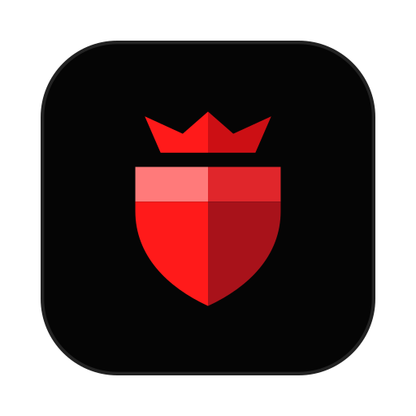
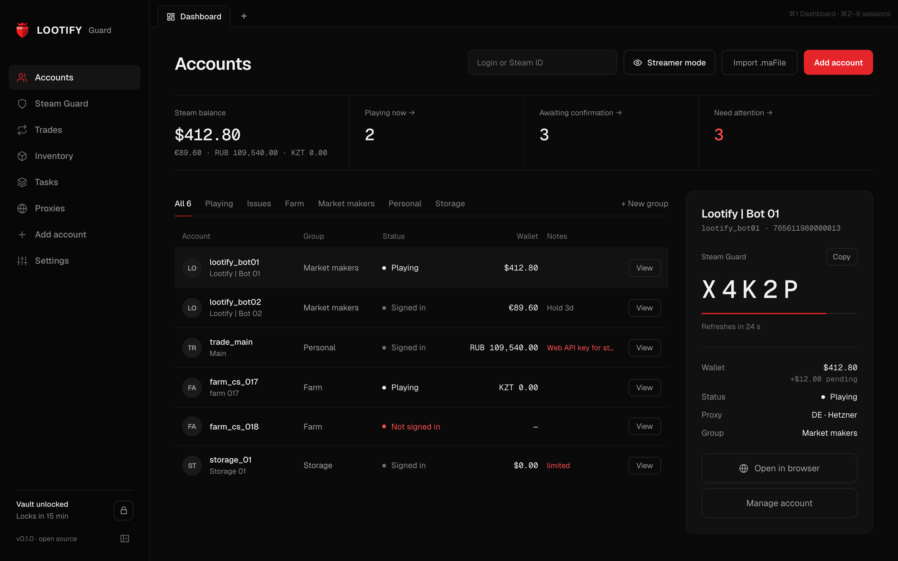
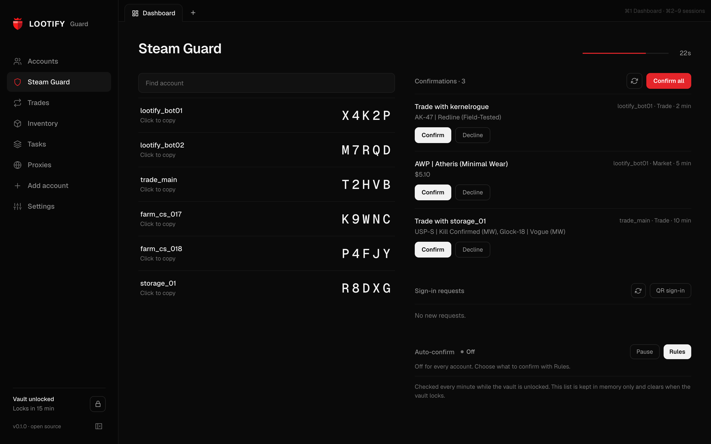

<div align="center">
  
  <h1>Lootify Guard</h1>
  <p>Many Steam accounts in one desktop app: Guard codes, confirmations, trades, inventories and proxies.<br>A companion to <a href="https://lootify.market">Lootify Market</a>. For macOS and Windows.</p>
  <p><a href="https://github.com/lootifymarket/lootify-guard/releases/latest"><b>Download</b></a></p>
</div>



## What it does

- **Steam Guard.** Codes for every account, trade and market confirmations, sign-in approvals and QR sign-in, and auto-confirm rules you set per account.
- **Accounts.** Sign in and set up Guard, import `.maFile` from SDA, ASF or steamguard-cli, or move Guard over from a phone.
- **Profiles.** Nickname, avatar, privacy, custom URL, trade URL and wallet, plus checks for foreign Web API keys, signed-in devices, bans, limited status and market access.
- **Trades and inventory** across all accounts: accept and send offers, move items to one account, list them on the Steam market.
- **Proxies and tasks.** A proxy per account, groups, and bulk tasks with delays between accounts: hour boost, card farming, free games, sale events, profile changes.
- **Steam in a tab**, signed in as the account and going through its proxy.
- English, Russian, Ukrainian and Chinese.



## Your data stays on your computer

- Passwords, Guard secrets and Steam tokens live in an encrypted vault (Argon2id and AES-256-GCM), unlocked with a master password or Touch ID. They're never sent anywhere, Lootify's servers included.
- An account with a proxy talks to Steam only through that proxy.
- No telemetry.

## Install

Download the latest build from [Releases](https://github.com/lootifymarket/lootify-guard/releases):

- **macOS 14 or newer** (Apple Silicon and Intel): `.dmg`, or `.zip` with the app inside.
- **Windows 10 or 11**: `-setup.exe` installs it; `-portable.zip` runs without installing.

The builds aren't signed yet, so the system warns before the first launch:

- **macOS** says the app can't be checked. Open System Settings → Privacy & Security and press **Open Anyway** next to Lootify Guard. Or run `xattr -dr com.apple.quarantine "/Applications/Lootify Guard.app"`.
- **Windows** shows "Windows protected your PC". Press **More info**, then **Run anyway**.

`SHA256SUMS.txt` in each release lists the files' checksums.

After that the app updates itself. It checks for new versions, downloads them and checks their signature. Turn this off in Settings → Updates to install them yourself.

## Building from source

You need Rust (stable), Node.js 22+ and the [Tauri prerequisites](https://v2.tauri.app/start/prerequisites/) for your OS.

```sh
npm install
npm run tauri dev     # run it
npm run tauri build   # build an installer
```

`tauri build` also signs the update packages, so it needs a signing key. Make your own with `npx tauri signer generate`, then put the key and its password in `TAURI_SIGNING_PRIVATE_KEY` and `TAURI_SIGNING_PRIVATE_KEY_PASSWORD`. Your builds then won't take updates from this repo, since those are signed with Lootify's key.

The Rust code is in `crates/core` (Steam, the vault, everything that doesn't need a window) and `src-tauri` (the app around it). The interface is React in `src`.

## Releasing

1. Raise the version on `dev`: `npm run release:version 0.2.0`, and merge it.
2. Open a PR from `dev` into `main`. What it says becomes the release notes.
3. Merge it. GitHub Actions builds both platforms into a draft release.
4. Check the draft and publish it. Publishing makes the `v0.2.0` tag, and installed apps pick the new version up from `latest.json`.

The workflow signs updates with the `TAURI_SIGNING_PRIVATE_KEY` and `TAURI_SIGNING_PRIVATE_KEY_PASSWORD` secrets. The matching public key is in `src-tauri/tauri.conf.json`. Losing the private key means installed apps can't be updated anymore.

## License

[GPL-3.0](LICENSE). You can use, change and share it, and anything built from it has to stay open under the same license.

Lootify Guard isn't affiliated with Valve. Steam is a trademark of Valve Corporation.
